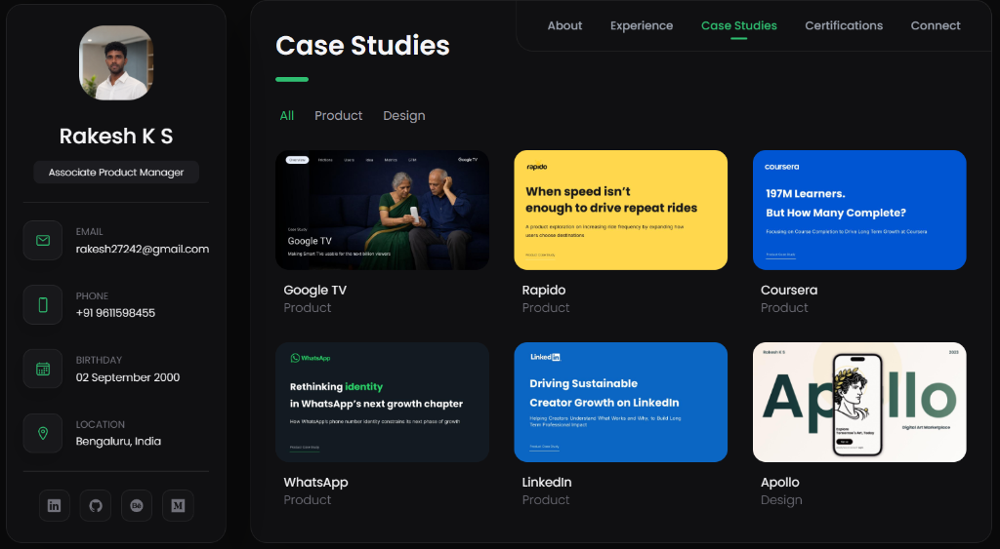

<h1 align="center">Rakesh K S - Portfolio</h1>

  
  

 

  Associate Product Manager | FinTech | B2B SaaS | GenAI

---

## Portfolio Preview

---

## About Me

I'm **Rakesh K S**, an **Associate Product Manager based in Bengaluru, India**, with experience across **FinTech, B2B SaaS, and GenAI**.

At **Melento**, I've worked on **digital signature platforms, payment solutions, and AI-powered document tools**. My work spans **product discovery, customer research, product strategy, roadmap prioritization, analytics, and execution**, collaborating with engineering, design, and business teams to build solutions that simplify workflows and deliver business value.

I enjoy breaking down complex problems, identifying opportunities, and turning ideas into products that solve real customer needs.

---

## Portfolio Sections

This portfolio website showcases my work and experience across the following sections:

| Section | What you'll find |
| :-- | :-- |
| **About** | Overview of my product management approach and focus areas |
| **Experience** | My professional experience as an Associate Product Manager |
| **Education** | My academic background in Electronics & Communication Engineering |
| **Portfolio** | Product and design case studies |
| **Certifications** | Professional certifications in product management and UX design |
| **Contact** | Ways to connect with me |

---

## Tech Stack

  
  
  

The website is built using **HTML, CSS, and JavaScript**, and is designed to be **fully responsive across devices**.

---

## Connect With Me

  
  <a href="mailto:rakesh27242@gmail.com">
    

